# CivicHelp — Autonomous Civic Incident Intelligence Platform

[](https://github.com/aryanTmall/Apex-Coderss)
[](https://frontend-amber-sigma-28.vercel.app/)
[](https://ai.google.dev/)
[](https://github.com/aryanTmall/Apex-Coderss)
[](https://sushantuniversity.edu.in)

> **"From Citizen Reports to Verified Outcomes"** — An autonomous resolution mesh, evidence verification engine, and municipal accountability platform built for real-world smart cities.

---

## 👥 Team Information (Apex Coders)

* **Team Name:** Apex Coders
* **College / Organization:** Sushant University
* **Team Members:**
  * **Aryan Mall** (Team Leader)
  * **Aditya**
  * **Bhavy Nanda**
  * **Ashish Kumar**
* **Project Repository:** [https://github.com/aryanTmall/Apex-Coderss](https://github.com/aryanTmall/Apex-Coderss)
* **Live Web App (Vercel):** [https://frontend-amber-sigma-28.vercel.app/](https://frontend-amber-sigma-28.vercel.app/)
* **Presentation Deck:** Available in root as [`CivicHelp_Hackoween_ApexCoders.pptx`](./CivicHelp_Hackoween_ApexCoders.pptx) and [`CivicHelp_Hackoween_ApexCoders.pdf`](./CivicHelp_Hackoween_ApexCoders.pdf)

---

## 🔑 Evaluator 1-Click Government Credentials

The live deployment on Vercel includes 1-click credential quick-fill pills on the [Government Login Page](https://frontend-amber-sigma-28.vercel.app/government/login):

| Role | Email | Password | Primary Console & Permissions |
| :--- | :--- | :--- | :--- |
| **Administrator** | `admin@civichelp.gov.in` | `CivicHelp@Admin2026!` | Full ops console, SLA escalation, department overrides, audit resets |
| **Verification Reviewer** | `reviewer@civichelp.gov.in` | `CivicHelp@Review2026!` | Visual QA desk, geofence audit inspection, unconfirmed report corroboration |
| **PWD Department Operator** | `pwd.operator@civichelp.gov.in` | `CivicHelp@Pwd2026!` | Contractor work order dispatch, SLA timers, repair logging |
| **Whistleblower Auditor** | `auditor@civichelp.gov.in` | `CivicHelp@Auditor2026!` | Restricted encrypted anti-corruption dossier queue, statutory notices |
| **Field Supervisor** | `field.crew@civichelp.gov.in` | `CivicHelp@Field2026!` | Post-repair evidence photo uploads, onsite inspection telemetry |
| **Finance Officer** | `finance@civichelp.gov.in` | `CivicHelp@Finance2026!` | Ward budget reconciliation, contractor penalty deductions & bonus release |

---

## ❓ The Big "Why": Why Does CivicHelp Need to Exist?

### The Real-World Crisis
In most modern cities, municipal apps function as **bureaucratic black holes**:
1. **The "Fake Closure" Epidemic:** Over **70% of civic complaints** are closed administratively without physical verification. Contractors or field workers upload photos of a completely different street, or reuse old pictures, to meet bureaucratic closure quotas.
2. **Zero Contractor Accountability:** Municipal corporations disburse hundreds of crores of taxpayer money annually. Yet, when a newly patched road craters 3 weeks later, there is no automatic system linking recurrence back to contractor trust scorecards or deducting financial penalties.
3. **Citizen Cynicism & Drop-off:** Citizens stop reporting because *"nothing ever actually gets fixed."* There is zero SLA visibility, emergency services are fragmented, and city budgets are buried in opaque PDF gazettes.
4. **Corruption Risks for Whistleblowers:** Field engineers or honest citizens who observe contractor fraud (such as using cheap bitumen binder) have nowhere safe to report without fear of retribution.

---

## 💡 The Solution: How CivicHelp Solves This

CivicHelp shifts civic management from **passive record storage** to an **autonomous resolution and accountability mesh**:

| Problem in Existing Apps | CivicHelp Solution | Real-World Impact |
| :--- | :--- | :--- |
| Complex, bureaucratic forms | **Bilingual Voice Assistant (Gemini AI)** & WhatsApp/SMS Gateway | Anyone can report by speaking naturally in Hindi or English. |
| Must stand on dangerous roads to report | **Dual Modes: Precise GPS & Unconfirmed Mode** | Report on-site with GPS, OR report from home safely without spoofing coordinates. |
| Fake closure photos uploaded | **Cryptographic Geofence Audit ($\le 50\text{m}$)** | Photos taken $>50\text{m}$ away are **automatically rejected and re-opened**. |
| Shoddy contractor work repeats | **Empanelled Contractor Scorecards & Penalty Engine** | SLA breaches automatically trigger contractual penalties (₹500/hr, ₹10k bad compaction). |
| Opaque municipal expenditures | **Ward Participatory Budgeting** | Citizens view live Ward spending and vote on projects (Solar lights vs. Bio-swales). |
| No citizen incentive to engage | **Civic Rewards System** | Earn points for verified reports, redeemable for **Delhi Metro (DMRC) passes** and tax rebates. |
| Fragmented emergency dispatch | **Live 112 Turn-by-Turn Road ETA** | Real-time driving distance and minute ETAs to nearest police, fire, & trauma centers via OSRM. |

---

## 🔄 End-to-End System Workflow Flowchart

```mermaid
flowchart TD
    %% STAGE 1: INTAKE
    subgraph S1["1. Multi-Channel Citizen Intake"]
        A1["Voice Assistant<br/>(Bilingual Hindi/English via Gemini)"]
        A2["Precise GPS Mode<br/>(On-site Pinpoint Geolocation)"]
        A3["Unconfirmed Mode<br/>(Delayed report without GPS spoofing)"]
        A4["Messaging Gateway<br/>(WhatsApp & SMS Simulation)"]
    end

    %% STAGE 2: AI TRIAGE
    subgraph S2["2. Autonomous AI Triage & Classification Engine"]
        B1["Gemini AI Classifier<br/>(14 Canonical Civic Categories)"]
        B2["Priority & Urgency Scoring<br/>(Safety hazard & Transit corridor)"]
        B3["Deterministic SLA Engine<br/>(8h to 72h Guaranteed Window)"]
        B4["Spatial Hotspot Clustering<br/>(Density analysis & Root-cause detection)"]
    end

    %% STAGE 3: DISPATCH
    subgraph S3["3. Municipal Operations & Contractor Dispatch"]
        C1["Department Assignment<br/>(Delhi PWD, DJB, MCD SWM, BSES)"]
        C2["Contingency Fallback Mesh<br/>(Auto-redirect if department is offline)"]
        C3["Empanelled Contractor Dispatch<br/>(Work order issued with SLA countdown)"]
    end

    %% STAGE 4: VERIFICATION
    subgraph S4["4. Cryptographic Verification Desk & Evidence Audit"]
        D1["Contractor Uploads Repair Evidence<br/>(Photo + Geolocation Telemetry)"]
        D2{"Geofence Audit<br/>Distance &le; 50 meters?"}
        D3{"SHA-256 Hash & Metadata<br/>Tamper check passed?"}
    end

    %% STAGE 5: OUTCOMES
    subgraph S5["5A. Verified Resolution (PASS)"]
        E1["Status set to RESOLVED"]
        E2["Block committed to Tamper-Evident SHA-256 Audit Chain"]
        E3["Citizen receives Civic Credits<br/>(DMRC Metro / Tax discount)"]
        E4["Contractor Trust Rating incremented"]
    end

    subgraph S6["5B. Autonomous Failure Recovery (FAIL)"]
        F1["Closure Rejected & Case Auto-REOPENED"]
        F2["Priority Escalated & Alert to Executive Engineer"]
        F3["Contractor Penalty Engine Triggered<br/>(&#8377;500/hr delay deduction)"]
        F4["Real-time Alert logged to Operational Feed"]
    end

    %% CONNECTIONS
    A1 --> B1
    A2 --> B1
    A3 --> B4
    A4 --> B1

    B1 --> B2
    B2 --> B3
    B3 --> C1
    B4 --> C1

    C1 --> C2
    C2 --> C3
    C3 --> D1

    D1 --> D2
    D2 -- "YES (&le; 50m)" --> D3
    D2 -- "NO (> 50m deviation)" --> F1

    D3 -- "YES (Valid proof)" --> E1
    D3 -- "NO (Tampered/Fake)" --> F1

    E1 --> E2
    E2 --> E3
    E2 --> E4

    F1 --> F2
    F2 --> F3
    F3 --> F4
    F4 -.->|"Re-assigned for corrective repair"| C3
```



---

## 🛠️ Deep Dive: The 7 Core Architectural Modules

### 1. Verification Desk & Anti-Fake Closure Recovery (`/government/verification`)
* **Haversine Geofence Verification:** Calculates mathematical distance between citizen report GPS and contractor closure photo telemetry.
* **Autonomous Recovery:** Rejection immediately reopens the case, increments priority (+1, capped at 5), advances the escalation tier, recalculates the SLA deadline, and deducts contractor trust score (-15%).
* **Cryptographic Tamper-Proofing:** Every image is stamped with a SHA-256 checksum at intake and closure.

### 2. Empanelled Contractor Scorecards & Penalty Lifecycle (`/government/contractors`)
* Empanelled contractors (**Apex Road Infrastructure, Jal Hydro Utilities, CleanCity Waste, BrightGrid Power**) have auditable trust scores (0–100%).
* Follows formal statutory transitions: `DETECTED` ➔ `EVIDENCE_REVIEW` ➔ `CALCULATED` ➔ `CONTRACTOR_NOTIFIED` ➔ `OFFICIAL_APPROVAL` ➔ `BILLING_ADJUSTMENT_PENDING` ➔ `RECONCILED`.

### 3. Municipal Fund Tracker & Fiscal Accountability (`/public/funds`)
* Public transparency dashboard tracking capital allocation versus recorded expenditure across 5 New Delhi wards (**Ward 42 Connaught Place, Ward 43 Karol Bagh, Ward 44 Hauz Khas, Ward 45 Civil Lines, Ward 46 Nehru Place**).
* 1-click CSV import/export for municipal accountants.

### 4. Confidential Whistleblower Vault (`/public/confidential-report` & `/government/whistleblower`)
* Zero-PII intake generating a 48-character non-guessable cryptographic secret token (`secrets.token_hex(24)`).
* Dedicated segregated storage in `uploads/confidential/` isolated from general operators.
* Whistleblowers track investigation findings without logging in or revealing personal identities.

### 5. Community Polls & Participatory Budgeting (`/public/participation`)
* Direct democracy voting on ward-level capital projects.
* Ballot integrity protected by SHA-256 ballot fingerprints (1-vote-per-citizen).

### 6. Civic Rewards & Gamified Engagement (`/public/rewards`)
* Append-only points ledger: +50 pts for verified reports, +30 for confirmed closures, +10 for participatory votes.
* Daily 250 pt cap preventing bot abuse.
* Instant voucher redemption for **Delhi Metro (DMRC)** travel credit, municipal property tax rebates, and native tree planting.

### 7. Emergency Services Directory with Live Road Routing ETA (`/emergency`)
* Real-time driving distance and minute ETAs to nearest physical stations (**Delhi Police Barakhamba Rd, AIIMS Trauma Centre, Delhi Fire Service HQ, Ram Manohar Lohia Hospital**) calculated via live OSRM routing.

---

## 💻 Tech Stack & Engineering Specifications

### Frontend Architecture
* **Core:** React 18, TypeScript, Vite 5
* **Design System:** Tailwind CSS ("Nocturne Operations" dark mode interface)
* **Spatial Mesh:** Leaflet 1.9.4, `leaflet.markercluster`, CartoDB Dark Matter / Google Maps tiles
* **Accessibility:** Category-specific geometric shapes + interior SVG glyphs (color-blind compliant)
* **AI Copilot:** Floating glassmorphic chat widget backed by Gemini AI
* **3D Hero:** Three.js procedural night-city instanced mesh

### Backend Engine
* **Core:** Python 3.11 / 3.14 compatible, FastAPI, Pydantic V2, SQLAlchemy 2.x
* **AI / Triage:** Google GenAI SDK (`google-genai`), model `gemini-3.8-flash`
* **Security & RBAC:** PBKDF2-HMAC-SHA256 password hashing (100,000 rounds), PyJWT Bearer auth
* **Spatial & Routing:** OSRM driving engine with 5-minute memory caching & Haversine fallback
* **PDF Engine:** ReportLab vector graphics engine with embedded SHA-256 seal
* **Audit Ledger:** Append-only SHA-256 chronological hash-linked blockchain-style chain
* **Automated Testing:** 69 / 69 passing unit & integration tests (`pytest`)

---

## 🚀 Quick Start (Local Development)

### 1-Click Launch (Windows)
Double-click `launch.bat` in the root folder, or run:
```powershell
python launcher.py
```

### Manual Setup

#### 1. Backend Server
```powershell
cd backend
python -m venv venv
venv\Scripts\activate
pip install -r requirements.txt
python -m uvicorn app.main:app --host 127.0.0.1 --port 8000 --reload
```
API Documentation will be live at `http://127.0.0.1:8000/docs`.

#### 2. Frontend Client
```powershell
cd frontend
npm install
npm run dev
```
Client will be live at `http://localhost:5173`.

#### 3. Run Automated Tests
```powershell
# Run full backend test suite (69 tests)
cd backend
python -m pytest tests/

# Run frontend build check (0 errors)
cd frontend
npm run build
```

---

## 📜 License & Acknowledgments

* **Hackathon:** Built for Hack-o-ween 2026.
* **Team:** Apex Coders, Sushant University (Aryan Mall, Aditya, Bhavy Nanda, Ashish Kumar).
* **Open Source Libraries:** FastAPI, React, Leaflet, Three.js, ReportLab, Tailwind CSS, Google Gemini.
