# CivicHelp: End-to-End System Architecture & Workflow Flowchart

```mermaid
flowchart TD
    %% STAGE 1: INTAKE
    subgraph S1["1. Multi-Channel Citizen Intake"]
        A1["Voice Assistant<br/>(Bilingual Hindi/English via Gemini)"]
        A2["Precise GPS Mode<br/>(On-site Pinpoint Geolocation)"]
        A3["Unconfirmed Mode<br/>(Delayed report without GPS spoofing)"]
        A4["Messaging Simulator<br/>(WhatsApp & SMS Gateway)"]
    end

    %% STAGE 2: AI TRIAGE
    subgraph S2["2. Autonomous AI Triage & Classification Engine"]
        B1["Gemini AI Classifier<br/>(14 Canonical Civic Categories)"]
        B2["Priority & Urgency Scoring<br/>(Safety hazard & Transit corridor)"]
        B3["Deterministic SLA Engine<br/>(8h to 72h Guaranteed Window)"]
        B4["Spatial Hotspot Clustering<br/>(Density analysis & Root-cause detection)"]
    end

    %% STAGE 3: DISPATCH
    subgraph S3["3. Municipal Operations & Contractor Dispatch"]
        C1["Department Assignment<br/>(Delhi PWD, DJB, MCD SWM, BSES)"]
        C2["Contingency Fallback Mesh<br/>(Auto-redirect if department is offline)"]
        C3["Empanelled Contractor Dispatch<br/>(Work order issued with SLA countdown)"]
    end

    %% STAGE 4: VERIFICATION
    subgraph S4["4. Cryptographic Verification Desk & Evidence Audit"]
        D1["Contractor Uploads Repair Evidence<br/>(Photo + Geolocation Telemetry)"]
        D2{"Geofence Audit<br/>Distance &le; 50 meters?"}
        D3{"SHA-256 Hash & Metadata<br/>Tamper check passed?"}
    end

    %% STAGE 5: OUTCOMES
    subgraph S5["5A. Verified Resolution (PASS)"]
        E1["Status set to RESOLVED"]
        E2["Block committed to Tamper-Evident SHA-256 Audit Chain"]
        E3["Citizen receives Civic Credits<br/>(DMRC Metro / Tax discount)"]
        E4["Contractor Trust Rating incremented"]
    end

    subgraph S6["5B. Autonomous Failure Recovery (FAIL)"]
        F1["Closure Rejected & Case Auto-REOPENED"]
        F2["Priority Escalated & Alert to Executive Engineer"]
        F3["Contractor Penalty Engine Triggered<br/>(&#8377;500/hr delay deduction)"]
        F4["Real-time Alert logged to Operational Feed"]
    end

    %% CONNECTIONS
    A1 --> B1
    A2 --> B1
    A3 --> B4
    A4 --> B1

    B1 --> B2
    B2 --> B3
    B3 --> C1
    B4 --> C1

    C1 --> C2
    C2 --> C3
    C3 --> D1

    D1 --> D2
    D2 -- "YES (&le; 50m)" --> D3
    D2 -- "NO (> 50m deviation)" --> F1

    D3 -- "YES (Valid proof)" --> E1
    D3 -- "NO (Tampered/Fake)" --> F1

    E1 --> E2
    E2 --> E3
    E2 --> E4

    F1 --> F2
    F2 --> F3
    F3 --> F4
    F4 -.->|"Re-assigned for corrective repair"| C3
```

---

## Detailed Step-by-Step Workflow Explanation

### Step 1: Citizen Intake (Universal Accessibility)
* **Voice-First Input:** Citizens speak in English or Hindi; the Gemini AI speech pipeline extracts the category, title, description, and landmarks.
* **Dual Location Options:**
  * **Precise Mode:** Captures exact device GPS coordinates on the spot.
  * **Unconfirmed Mode:** Allows citizens who couldn't report during their morning commute to report safely from home without spoofing GPS. The report enters the community corroboration queue.
* **WhatsApp/SMS Integration:** Reaches non-smartphone or low-bandwidth users without requiring app installation.

---

### Step 2: Autonomous Intelligence & SLA Allocation
* **Multilingual Classification:** Gemini AI automatically assigns the issue to one of 14 canonical categories (potholes, streetlights, garbage, water leaks, etc.).
* **Priority Engine:** Considers school zones, hospitals, high-traffic corridors, and structural risk to calculate priority (1 to 5).
* **Guaranteed SLA Timer:** Sets a contractual countdown (e.g. 8h for water main burst, 24h for arterial pothole, 48h for streetlights).
* **Root-Cause Analysis:** If 5 potholes cluster within 150m of a leaking water valve, the system flags the correlation: *"Sub-surface pipe erosion causing road failure."*

---

### Step 3: Department & Contractor Dispatch
* **Role-Based Routing:** Routed to the respective municipal division (Delhi PWD, Delhi Jal Board, MCD, or BSES Power).
* **Contingency Failover:** If a department is flagged offline or overloaded, the platform automatically routes the ticket to its designated secondary fallback.
* **Empanelled Contractor Work Order:** Contractual terms, assigned crew, and active penalty clauses attach to the work order.

---

### Step 4: Verification Desk & Anti-Fake Closure Audit
* **Geofence Boundary Check:** When a repair crew uploads an "after-repair" photo, the system calculates the Haversine distance between the original report coordinates and the photo upload coordinates.
  * Deviation $\le 50\text{m}$: Passes to visual inspection.
  * Deviation $> 50\text{m}$: **Immediately flagged for spoofing.**
* **Cryptographic Tamper-Proofing:** Each image is assigned a SHA-256 checksum at intake and closure, preventing substitution of stock photos or photos from other locations.

---

### Step 5: Closed-Loop Outcome

#### Outcome A: Verified Resolution (Success)
1. Incident status transitions to **RESOLVED**.
2. A new block is linked to the **immutable SHA-256 Audit Chain**.
3. The reporting citizen is awarded **Civic Credits**, redeemable for Delhi Metro passes, municipal property tax rebates, or tree-planting certificates.
4. The contractor's trust scorecard increases, maintaining eligibility for future municipal tenders.

#### Outcome B: Autonomous Recovery (Failure / Fake Closure)
1. The closure submission is rejected; the incident is automatically **REOPENED**.
2. Priority escalates by +1 tier, alerting the Division Executive Engineer.
3. The **Contractor Penalty Engine** calculates contractual deductions (e.g. ₹500 per elapsed hour beyond SLA, or ₹10,000 for substandard compaction).
4. A high-severity alert is dispatched to the **Operational Intelligence Feed** for administrative review.
